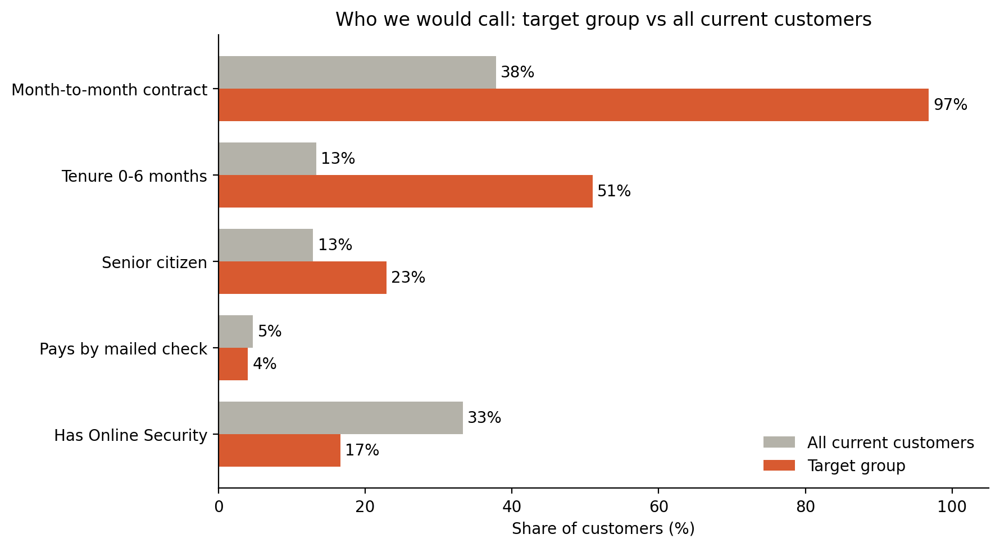
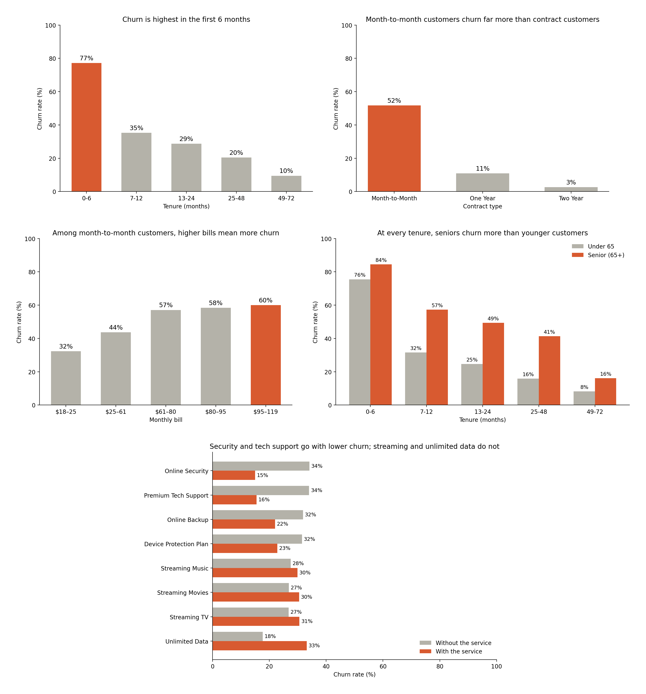
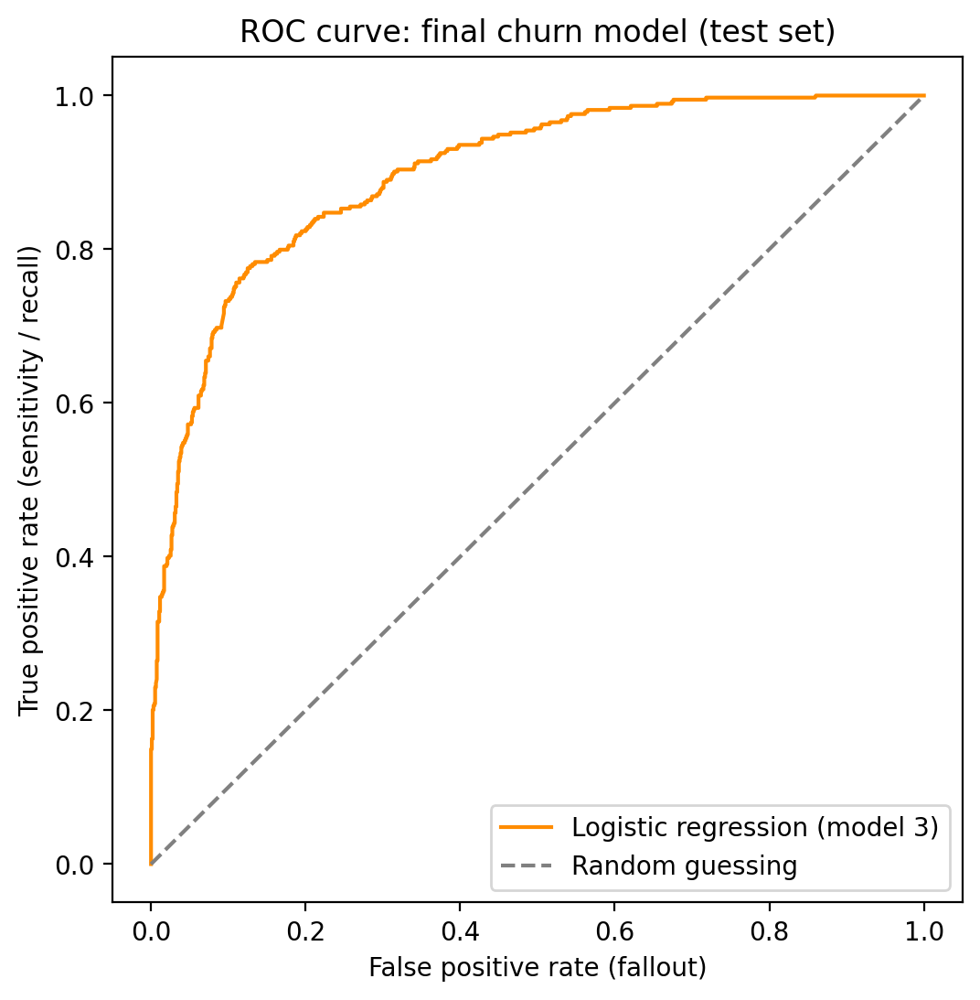
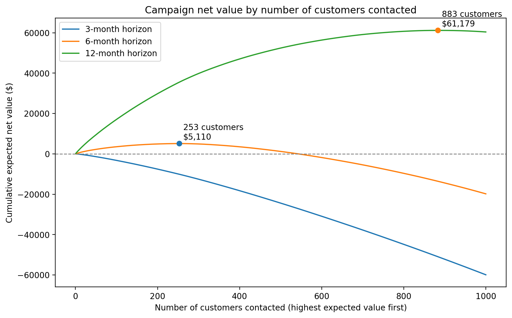

# 📞 Telco Customer Churn: Who Should We Call?

**A Python-based logistic regression project**: predicting which customers are likely to leave a telecoms company, then turning those predictions into a costed retention campaign (who to contact, how many, and whether it pays off). The analysis was performed using the public [IBM Telco Customer Churn dataset](https://www.kaggle.com/datasets/ylchang/telco-customer-churn-1113/data) from Kaggle.

---

## 📖 Introduction

My fourth portfolio project, and my first classification model. After building a linear regression model to predict [California house prices](https://github.com/nicolascrifasi1603/california-house-price-predictor-linear-regression), the next step in my data science learning was logistic regression: predicting a yes/no outcome rather than a number. Before that, I worked on SQL analysis of the [Olist E-Commerce dataset](https://github.com/nicolascrifasi1603/olist-ecommerce-analysis) and a Python EDA on the [Spotify Tracks Dataset](https://github.com/nicolascrifasi1603/Spotify-EDA-Python).

I wanted to learn how churn prediction works in industry, and especially how a model's probabilities become a business decision: who to contact, how many, and what return to expect. I then used the model's findings to suggest product strategies to reduce churn.

---

## 🚀 Project Overview

**Question:**
> A telecom lost about a quarter of its customers last quarter. **Which customers should it target with a retention offer to protect the most revenue, and is the campaign worth running at all?**

The project is framed around a brief from a (fictional) Head of Customer Retention:
- The retention team can offer a **$100 account credit**, to **1,000 customers at most** (fewer if that makes more financial sense).
- The offer keeps about **30%** of customers who were genuinely going to leave. Customers who would have stayed anyway still take the credit, so that money is wasted.
- The model runs at the **start** of the quarter, so it can only use information available at that point.

The objectives of this project were to:

1. 🎯 Score every current customer on their chance of leaving, with a model that can be explained, not a black box.
2. 📋 Recommend a target list and size, focusing on revenue at risk rather than headcount.
3. 💰 Estimate the financial outcome: revenue saved, campaign cost and net.
4. 💡 Give the product team actionable insights to reduce churn.

The full brief is in [`docs/brief.md`](docs/brief.md).

---

## 🏆 Headline Result

| 💵 Expected Revenue Saved | 📞 Best No. of Customers to Contact | 💸 Total Campaign Cost | ✅ Net Est. Savings |
|:---:|:---:|:---:|:---:|
| **$30,410** | **253** | **$25,300** | **$5,110** |

*Main case: saved customers stay for 6 months after taking the offer.*

**The campaign is worth running, but only just.** Contacting the 253 highest-value customers returns about $1.20 for every $1 spent on credits. The result depends heavily on how long saved customers stay: at 3 months no customer is worth contacting, while at 12 months the optimal list grows to 883 customers and the net rises to about $61,000 (see [Horizon Sensitivity](#-horizon-sensitivity)).

The targets are almost all **month-to-month customers** (97% of the 253, vs 38% of all current customers). That points to the biggest lever: tying the offer to a longer contract (see [Product Insights & Strategies](#-product-insights--strategies)).

### 👥 Who we'd contact

The 253 recommended customers look very different from the customer base as a whole:

| | All current customers (5,174) | Target group (253) |
|---|:---:|:---:|
| Month-to-month contract | 38% | **97%** |
| In their first 6 months | 13% | **51%** |
| Senior citizen (65+) | 13% | **23%** |
| Has Online Security | 33% | **17%** |
| Pays by mailed check | 5% | 4% |



- **Almost every target is on a month-to-month contract, and half are in their first 6 months.** These are customers who can leave at any time, at the point they're most likely to.
- **Mailed-check payers aren't over-represented,** despite their higher odds of leaving. They make up only 5% of customers, and the ranking also weighs how much each customer pays.
- **This profile is partly by design:** the model picks customers with the traits it links to churn, so it describes *who* we'd call rather than proving *why* they leave.

---

## 🔄 Project Workflow

| Step | What I did |
|---|---|
| 📥 **Load & merge** | Loaded five tables (services, status, location, demographics, population), checked `Customer ID` was unique in each, and merged them into one dataset of 7,043 customers, with the row count unchanged at every step. |
| 👥 **Define the training customers** | Created `active`: the 6,589 customers who were with the company on 1 July (those who stayed plus those who left in Q3). The 454 customers who **joined** during Q3 were excluded, because they weren't customers at the start of the quarter. This mirrors how the model will be used: on the customers we have at the start of a quarter. |
| 🚧 **Data audit & feature selection** | Passed every candidate column through five gates (availability, leakage, redundancy, signal, practicality), holding other drivers constant (e.g. tenure, contract) to check each signal was real. |
| 📊 **EDA** | Explored churn by tenure, contract, price, age, services and churn reason, and quantified the revenue lost to churn. |
| 🔧 **Feature engineering** | Grouped tenure into bands, combined phone service and multiple lines into one column, filled blank internet types as "None", one-hot encoded categories and scaled the numeric feature. |
| 🤖 **Modelling** | Trained three logistic regression models, dropping `Referral Band` and then `Monthly Charge`, to reach the final model. |
| 📏 **Evaluation** | Tested the final model on about 1,300 held-out customers it never saw during training (AUC), and compared train vs test AUC to check for overfitting. |
| 🎯 **Scoring current customers** | Took the 5,174 current customers (those who stayed plus those who joined in Q3), ran them through the same preparation steps and fitted scaler, and gave each one a chance of leaving. Customers who left in Q3 were excluded, since they can't be contacted. |
| 💰 **Business translation** | Calculated each customer's expected net value, picked the optimal number to contact, and tested how the result changes across 3, 6 and 12-month horizons. |

---

## 🗂️ Dataset Overview

- **Source:** [IBM Telco Customer Churn dataset](ADD-KAGGLE-LINK), version 11.1.3+, multi-table version (Kaggle)
- **Size:** 7,043 customers across five tables (services, status, location, demographics, population)
- **Scope:** a single Q3 snapshot of customers in California
- **Note:** the data is fictional, generated by IBM. Totals and tenure are measured to the end of the quarter (or to the leave date for customers who left), which matters for leakage.

---

## 💡 Key Findings

### 📉 The customer base and what churn cost us


Of the 7,043 customers in the Q3 data, **1,869 (26.5%) left during the quarter**. They weren't a random slice of the base:

- Leavers paid **$74 a month** on average, vs $63 for customers who stayed.
- So the 26.5% of customers who left took **32% of monthly revenue** with them: **$139,131 a month**.
- If those customers had stayed, that's about **$835,000** of revenue over the next 6 months (a projection: monthly revenue lost × 6).

### 🔑 What drives churn

Two kinds of evidence for each driver:
- **Raw data:** churn rates in the Q3 data, for the 6,589 customers who were with the company on 1 July.
- **Model:** how the odds of leaving change for this driver alone, compared with otherwise similar customers (same tenure, contract, services and so on).

| Driver | Raw data: Q3 churn rates | Model: effect on the odds of leaving |
|---|---|---|
| 🆕 **New customers** | ~78% of customers in their first 6 months left. Median tenure: 10 months for leavers vs 42 for stayers | After 6 months, the odds of leaving are 82–91% lower |
| 📄 **Month-to-month contracts** | ~52% of month-to-month customers left, vs ~11% on one-year and ~3% on two-year contracts | Two-year contract: ~95% lower odds. One-year: ~77% lower |
| 💵 **Higher bills** | Among month-to-month customers alone, churn rises from 32% (bills under $25) to 60% (bills over $95) | Not in the model: the bill is almost fully explained by which services a customer has (R² = 0.99), so price is shown from the raw data only |
| 👴 **Seniors (65+)** | Comparing customers with the same tenure, seniors churn about twice as often. E.g. among customers with 25–48 months' tenure: 41% of seniors left vs 15–17% of each younger age group | ~2x the odds |
| 🛡️ **Online Security / Tech Support** | Among month-to-month customers: 35% churn with these services vs 60% without | ~28% lower odds |



*Q3 churn rates, 6,589 customers active on 1 July.*

**How to read the model column.** Logistic regression estimates a coefficient for each feature. Converted into an **odds ratio** (e^coefficient), it says how much the odds of leaving are multiplied when that feature is present, with everything else held equal:
- **1** = no effect.
- **Below 1** = lower odds. 0.5 halves them.
- **Above 1** = higher odds. 2.0 doubles them.

Odds are not the same as probability. Doubling the odds takes a 20% chance of leaving to 33%, not to 40%.

**Service effects partly reflect price.** Each service adds to the bill, and higher bills go with more churn. Online Security and Tech Support still show lower churn despite that push, which makes them the most trustworthy service findings. Even so, they show what *goes with* lower churn, not proof of what causes it.

### 🤖 The logistic regression model

#### Feature selection: five gates

Every candidate column had to pass five gates:

1. **Availability:** would we know this value on day one of the quarter?
2. **Leakage:** is it a cause of churning, or a consequence of it?
3. **Redundancy:** is it a copy of another feature?
4. **Signal:** does churn differ across its values, even after holding other strong drivers constant?
5. **Practicality:** can the model use it sensibly, and can a stakeholder understand it?

#### Three model iterations

| Model | Features | Test AUC | Why it changed |
|---|---|---|---|
| 1 | All features that passed the gates | 0.923 | Starting point |
| 2 | Minus `Referral Band` | 0.901 | 1 referral had ~3x the odds of churning while 2+ had lower odds, with no business explanation. The count may also include referrals made during Q3 |
| **3 (final)** | Minus `Monthly Charge` | **0.899** | The services rebuild the bill almost exactly (R² = 0.99), so coefficients flipped in ways that made no sense. Price is kept as an insight from the raw data instead |

The final model gives up a little accuracy (AUC 0.923 → 0.899) in exchange for features that are safe to use on day one and coefficients that can be explained.

#### Key odds ratios (final model)

| Feature (vs reference) | Odds ratio | In plain terms |
|---|---|---|
| Two-year contract (vs month-to-month) | 0.05 | ~95% lower odds |
| Tenure 49–72 months (vs 0–6) | 0.09 | ~91% lower odds |
| Tenure 7–12 months (vs 0–6) | 0.18 | ~82% lower odds |
| Has dependents | 0.20 | ~80% lower odds |
| One-year contract (vs month-to-month) | 0.23 | ~77% lower odds |
| Credit card (vs bank withdrawal) | 0.66 | ~34% lower odds |
| Online Security / Premium Tech Support | 0.72 | ~28% lower odds |
| Mailed check (vs bank withdrawal) | 1.75 | ~75% higher odds |
| Senior citizen (65+) | 1.99 | ~2x the odds |

*The full coefficient table is in the notebook (Section 5.4). Streaming services, `Married` and `Internet Type` are left out here: once the bill is removed from the model, these features pick up part of its price effect, so their odds ratios don't reflect a genuine effect.*

#### Model evaluation

| Metric | Value |
|---|---|
| Test AUC | 0.899 |
| Train AUC | 0.907 |

Below is the ROC curve for the final iteration of the logistic regression model:




### 💰 Financial outcome

**Expected revenue saved per customer:**

$$
\text{Expected revenue saved} = P(\text{leaving}) \times 0.3 \times \text{monthly bill} \times \text{horizon (months)}
$$

**Expected net per customer:**

$$
\text{Expected net} = \text{Expected revenue saved} - \$100
$$

Customers are **ranked by expected net, not by chance of leaving**, and everyone with a positive expected net is contacted (up to the 1,000 cap).

Ranking by chance of leaving alone would be a mistake. A customer with a 90% chance of leaving who pays $50 a month is worth 0.9 × 0.3 × $50 × 6 = $81 over 6 months, which is less than the $100 credit. A customer with a lower chance but a higher bill can be worth more.

**Why 6 months is the main case.** The horizon is how long a saved customer stays after taking the credit. It is an assumption, not something the data can tell us:
- **3 months is pessimistic.** It assumes every saved customer leaves straight after the quarter.
- **12 months is optimistic.** 97% of targets are on month-to-month contracts and can leave at any time.
- **6 months** sits between the two, with 3 and 12 months shown as sensitivity cases. The horizon was chosen by reasoning about customer behaviour, not by picking whichever gives the most money.

### 📈 Horizon Sensitivity

| Horizon (months) | Optimal number of contacts | Expected revenue saved | Cost | Net (optimal) | Net (contact 1,000) |
|---:|---:|---:|---:|---:|---:|
| 3 | 0 | $0 | $0 | $0 | −$59,899 |
| **6** | **253** | **$30,410** | **$25,300** | **$5,110** | **−$19,799** |
| 12 | 883 | $149,479 | $88,300 | $61,179 | $60,402 |



- **Contacting more customers isn't always better.** At 6 months, net value peaks at 253 customers and then falls. Contacting all 1,000 would lose about $20,000.
- **The ranking is the same at every horizon.** Only the cut-off point and the total change, so the same target list works whichever horizon turns out to be right. It just gets longer as the horizon grows.
- **How long saved customers stay matters more than anything else.** That's the case for tying the credit to a contract (Problem 2 below).

### 🧭 Product Insights & Strategies

*These are hypotheses to test against a control group, not proven fixes.*

#### Problem 1: New customers (0–6 month tenure) churn far more than long-standing ones
~78% of customers in their first 6 months left in Q3.

- Provide a structured and personalised onboarding period: this should outline each step of the onboarding journey, from the initial credit check to taking delivery and setting up devices. This should leave customers more satisfied from day one. You can provide welcome kits with personalised messages, and fun, simple how-to guides for setting up devices. Consider also giving a nudge towards the services that go with lower churn (Online Security, Tech Support), and a "quick win" in the first few weeks.

#### Problem 2: Month-to-month customers churn far more than contract customers
~52% of month-to-month customers left in Q3, vs ~11% on one-year contracts. They also make up 97% of the campaign's targets.

- Give month-to-month customers a reason to commit for longer: tie the $100 retention credit to a 12-month contract, so a saved customer is locked in rather than free to leave the next month. This alone could raise the campaign's net from ~$5,000 to ~$61,000, the difference between saved customers staying 6 months and 12. Make the contract more attractive with added value rather than just a discount, for example by bundling Online Security or Premium Tech Support at no extra cost. Month-to-month customers with these services churn at 35% vs 60% without, and 39% of at-risk telecom customers say extra services at the same price would make them stay ([Simon-Kucher, 2026](https://www.simon-kucher.com/en/insights/retention-battle-why-telcos-struggle-lock-high-value-customers)). Let customers pay monthly on the annual term, so the upfront cost isn't a barrier.

#### Problem 3: Mailed-check payers churn more
~75% higher odds of leaving than otherwise similar customers who pay by bank withdrawal.

- Test moving mailed-check payers onto automatic payment. The data doesn't show why these customers leave more, but one possibility is that writing a cheque each month turns every bill into a decision point: the customer sees the amount and has to act, which may prompt them to shop around. Automatic payment removes that monthly prompt. Offer a randomly chosen half of mailed-check payers an easy switch to autopay (e.g. a small one-off credit for switching), then compare their churn after 3 months with the half who weren't offered it.

---

## 📁 Repository Structure

```
├── Telco_churn_predictor_final.ipynb   # Full analysis and modelling notebook
├── images/                             # Charts used in this README
│   ├── q3_customer_status_pie.png
│   ├── churn_drivers.png
│   └── campaign_net_by_contacts.png
├── docs/
│   └── brief.md                        # The full problem statement
├── data/
│   └── README.md                       # Data source and download instructions
├── README.md
```

---

## 🛠️ How to Use This Project

1. **Clone the repo** and open it in Jupyter or VS Code.
2. **Download the dataset** from Kaggle (linked above) and place the five CSVs in the project folder. They aren't included in this repo (see [`data/README.md`](data/README.md)).
3. **Install the required packages:** pandas, numpy, matplotlib, seaborn, scikit-learn.
4. **Run `Telco_churn_predictor_final.ipynb`** from top to bottom to reproduce the full analysis.
5. **Cross-reference the notebook** against the workflow and findings in this README to follow the reasoning behind each step.

---

## 🔗 Connect

If you'd like to discuss this project or data analytics roles, feel free to connect with me on [LinkedIn](http://www.linkedin.com/in/nicolascrifasi).
